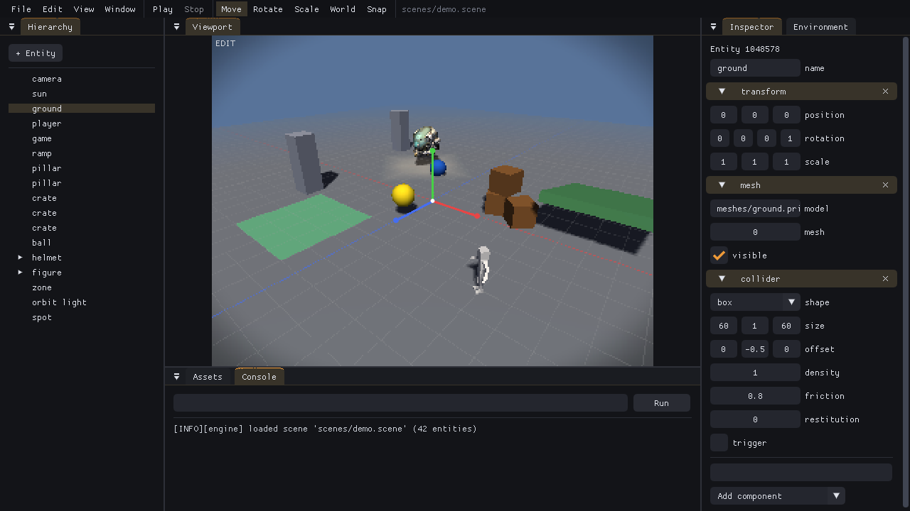

# The editor

`wpe_editor` edits a project: it opens the project's scenes, lets you change entities, components and the environment, plays the game in place, and exports it. People use its window; AI agents (and scripts) use the same editor through **JSON commands**. The two are equal: every change the window makes is one of those commands, so the commands have the same validation, the same undo history and the same results as clicking.

```bash
./build/bin/wpe_editor assets                                   # the window (and the command server)
./build/bin/wpe_editor my_game --init                           # a new project (see runtime.md), then the window
./build/bin/wpe_editor assets --command '{"cmd": "list_entities"}'   # one-shot, headless
./build/bin/wpe_editor assets --run commands.jsonl              # a batch, headless
./build/bin/wpe_editor --send '{"cmd": "status"}'               # talk to a running editor
```

## The window



| Area | What it does |
|---|---|
| Menu and toolbar | **File:** new, open, save, save as, export, quit.<br>**Edit:** undo, redo, duplicate, delete, focus on the selection.<br>**View:** the 2D view, the grid and its spacing, physics shapes, light icons, reloading changed scripts, snapping and its steps.<br>**Window:** reset the layout.<br>**Play controls:** play, pause, stop.<br>**Gizmo:** move, rotate or scale; **World**/**Local** axes; **Snap**; **2D** switches between the 3D and 2D views.<br>The open scene is shown with `*` when it has unsaved changes. |
| Viewport | The game's framebuffer, rendered by the engine. In edit mode it uses the editor's camera:<br>• **Fly:** hold the right mouse button and use WASD (Q/E down/up, Shift faster; the wheel changes the speed).<br>• **Dolly:** the wheel without the right button moves forward and back.<br>• **Select:** click an object; clicking a model selects the entity that placed it.<br>• **Gizmo:** drag a handle of the selection, in the mode W (move), E (rotate) or R (scale). Move and scale have a handle per axis (X red, Y green, Z blue); rotate has a ring per axis. Drag a ring along its edge, and the angle is shown while you drag. X switches between the world's axes and the entity's own; scaling always uses the entity's own.<br>• **Add a model:** drop one from Assets.<br>• **Grid:** lines on the ground plane (y = 0) around the camera, X axis red and Z axis blue, shown in edit mode.<br>• **Physics shapes:** collider wireframes:<br>&nbsp;&nbsp;– static: green<br>&nbsp;&nbsp;– kinematic: blue<br>&nbsp;&nbsp;– dynamic: orange, or grey while asleep<br>&nbsp;&nbsp;– triggers: yellow<br>They're shown in edit mode, where they follow every move and rescale, and while playing.<br>• **Light icons:** every light has an icon in its color, drawn over the scene in edit mode: a bulb for point lights, a cone showing the direction and angle of spot lights, and a sun with an arrow along directional lights. The selected light's icon has an orange ring, and clicking an icon selects its light. |
| Viewport, 2D view | Turn it on with **2D** in the toolbar. It shows what the game shows: the scene's own camera (or only the clear color, for a 2D scene without one) with the UI on top. The 3D view hides the UI, since it would cover the scene.<br>• **Outlines:** every UI element has a faint outline, so text-only and empty elements can be found.<br>• **Select:** click an element (the topmost one under the mouse).<br>• **Move:** drag an element.<br>• **Resize:** drag one of the selection's eight handles.<br>• **Anchors:** blue diamonds show where the selection's corners are anchored in its parent.<br>Drags change the element's offsets in whole pixels; with Snap on (or Ctrl held) they land on multiples of the UI step (View menu, default 8 pixels). |
| Hierarchy | Every entity, as a tree. Click to select, double-click to bring it into view. Drag onto another entity to reparent, or onto the empty area below to make it a root. The right-click menu duplicates, deletes or detaches, and saves an entity and its children as a prefab. Prefab instances show in blue (the root brighter), and their menu applies, reverts or unpacks them.<br>**+ Entity** adds an empty entity or a UI element: a panel, a text, or a button with a label. A new UI element goes inside the selected UI element (select a panel first to fill it), and the view switches to 2D. |
| Inspector | The selected entity in the scene-file schema: every field of every component, editable. Each component's × removes it. "Add component" adds one; a mesh, sound, sprite image or script takes the asset path typed in the box above it. For prefab instances, a bar names the prefab and offers Apply, Revert all and Unpack. Components that differ from the prefab are marked "(overridden)", and right-clicking their header reverts them.<br>A collider's **Fit to meshes** sizes and centers it around the meshes of the entity and its children (a box gets their extents, a sphere half the largest one, a capsule stands up around them; convex and mesh colliders already follow their model). An entity with meshes and no collider gets **Add box collider fitted to meshes**. |
| Environment | The scene's render settings, fog, shadows, post-processing, gravity and music. |
| Assets | The project's files. Double-click a scene to open it, or a model (`.glb`, `.gltf`, `.prim`) or prefab (`.prefab`) to place it. An image (`.png`, `.jpg`) becomes a UI sprite at its own size. Drag models, prefabs and images into the viewport. |
| Console | Log messages, and a command line that runs JSON commands exactly as an agent would. |

Shortcuts:
- **Editing:** Ctrl+Z / Ctrl+Y undo and redo, Ctrl+S save, Ctrl+D duplicate, Del delete.
- **Playing:** F5 play (Shift+F5, or F5 while playing, stops), F6 pause.
- **Gizmo:** W / E / R choose move, rotate or scale; X switches world/local axes; hold Ctrl while dragging to snap (or, with Snap on, to move freely).
- **View:** F focuses on the selection; G toggles the grid, P the physics shapes, L the light icons.

**Focus** (F, or double-click in the hierarchy) moves the editor camera, keeping its direction, so the selection and its children fill the view.

**Snapping** works in steps you set in the View menu (default 0.5 units, 15°, 0.1):
- **Moving along world axes** puts the position on multiples of the step, lining objects up with the grid.
- **Moving along local axes** moves in whole steps.
- **Rotating** turns in whole steps.
- **Scaling** lands on multiples of the step.

The value shows next to the gizmo while you drag.

**Unsaved changes are never lost by accident.** Starting a new scene, opening another one, quitting, or closing the window with unsaved changes asks first: Save, Don't save, or Cancel. A scene that was never saved asks for a name. Agents get the same protection: `new_scene`, `load_scene` and `quit` refuse while the scene has unsaved changes, unless they say `"discard": true`.

**Script hot reload:** while it's on (the default), changed scripts are reloaded twice a second, in edit mode and while playing. Running instances switch to the new code and keep their state (`on_reload` is called). A script that fails to compile is reported in the console, and the previous version keeps running.

**Play mode** runs the game from the current scene: scripts, physics, audio and input work as in the runtime, with the game's own camera. Keyboard and mouse reach the game while the viewport is focused; gamepads always do. **Stop** returns the scene to exactly how it was when play started, and the scene can't be edited while it plays. A game that calls `wpe.quit()` simply stops.

## Commands

A command is a JSON object `{"cmd": name, ...}`. The reply is always a JSON object:

```json
{"result": ..., "ok": true, "log": []}
{"result": null, "ok": false, "error": "entity 999 does not exist (list_entities shows the ids)", "log": ["[ERROR][...] ..."]}
```

`log` holds the warnings and errors logged while the command ran, such as a loader's exact complaint and line. Entities are identified by their **ids** (live handles): `list_entities` shows them and commands return them. Undo, redo, stop and loading re-create the world, which changes ids, so list again after those.

Entities and components use the **scene-file schema** ([scenes.md](scenes.md)), with ids as references. `get_entity` returns an entity exactly as `create_entity` takes it.

| Command | Arguments → result |
|---|---|
| `help` | → every command with its arguments |
| `status` | → project, scene, mode (`edit`/`play`/`paused`), dirty, selection, entity count, undo/redo depth |
| `project` | → the project settings (project.json) |
| `list_entities` | → `[{id, name, parent, components, prefab?}]`. `prefab` is `{path, root}` for members of prefab instances. |
| `get_entity` | `{id}` → the entity (`{"id", "name", "parent", "transform": {...}, "light": {...}, ...}`) |
| `create_entity` | `{entity: {name, parent, transform, instance, mesh, light, ..., script}}` → id (and selects it). With `"prefab": {"path": ...}` it places a prefab instance; the other keys given then replace the root's. |
| `duplicate_entity` | `{id}` → id of the copy (children are not copied) |
| `delete_entity` | `{id}` (with its children) |
| `set_component` | `{id, component, value}` → the entity. Replaces the component as a whole: fields left out take their defaults, so read the entity first to change one field. `component` can also be `"name"` or `"parent"`. |
| `remove_component` | `{id, component}` |
| `set_parent` | `{id, parent: id or null, keep_world = true}`. Members of prefab instances keep their place; only the instance root can move. |
| `save_prefab` | `{id, path}` → `{path, reloaded}`: saves the entity and its descendants as a prefab file, and they become an instance of it. Its root is stored at the origin. |
| `apply_prefab` | `{id}` (any member) → `{path, reloaded}`: writes the instance's changes and added children into its prefab. Other instances get the changes through a scene reload (`reloaded: true`, entity ids change). |
| `revert_prefab` | `{id, component?}` → root id: reverts one component (or `"name"`) of a member to the prefab, or, without `component`, rebuilds the whole instance (overrides and added children go). |
| `unpack_prefab` | `{id}`: turns the instance into plain entities, no longer linked to the prefab |
| `select` | `{id or null}` |
| `get_environment` / `set_environment` | `{}` / `{value: {...}}` (merged: keys left out keep their values) → the environment |
| `new_scene`, `load_scene`, `save_scene` | `{discard?}`, `{path, discard?}`, `{path?}`: asset paths inside the project; `save_scene` without a path saves the open scene. `new_scene` and `load_scene` refuse while the scene has unsaved changes, unless `"discard": true`. |
| `get_view` / `set_view` | `{}` / `{value: {grid, grid_spacing, physics, lights, gizmo: "move"\|"rotate"\|"scale", gizmo_space: "world"\|"local", hot_reload, snap, snap_move, snap_rotate (degrees), snap_scale, mode: "3d"\|"2d", snap_ui (pixels)}}` (merged; all or nothing) → the view. `mode: "2d"` renders edit mode from the scene's camera with its UI (screenshots too); UI elements are edited with `set_component` on `"ui"`. View settings aren't part of the scene: they are never saved or undone. |
| `undo`, `redo` | `{}` |
| `play`, `pause`, `stop` | `{}` (play also resumes) |
| `frames` | `{count = 1, dt = 1/60}`: runs frames (simulated in play mode) |
| `screenshot` | `{path, target = "game" or "editor"}`: the game view, or the whole editor window (also headless) |
| `camera` | `{position: [x,y,z], target: [x,y,z]}`: aims the editor camera |
| `fit_collider` | `{id = the selection}` → the entity: sizes and centers its collider (a new box when it has none) around the meshes of the entity and its children, measured in the entity's own space so its scale still applies. Other collider settings are kept. |
| `focus` | `{id = the selection}` → `{position, target}`: moves the editor camera, keeping its direction, until the entity and its children fill the view |
| `run_lua` | `{code}`: runs Luau with the `wpe` API (undoable; a failing chunk changes nothing) |
| `list_assets` | `{prefix?}` → asset paths |
| `export` | `{output, runtime?}` → `{files, bytes}`: exports the game (runtime/export, [runtime.md](runtime.md)) |
| `log` | `{count = 50}` → recent log lines |
| `quit` | `{discard?}`: closes the editor window (refused while the scene has unsaved changes, unless `"discard": true`) |

Any command may carry `"coalesce": key`. Consecutive edits with the same key form one undo step; the window uses this so that dragging a slider is one step.

### Three ways to send commands

- **Headless, one-shot:** `wpe_editor <project> --command '<json>' [--command ...]` opens the project, runs the commands, prints one reply per line and exits. The exit code is 0 only if every command succeeded.
- **Headless, batch:** `wpe_editor <project> --run <file>` does the same for a JSON array of commands or one command per line (JSON lines). Changes persist only through `save_scene`.
- **Live:** the editor window listens on `127.0.0.1:47800` (`--port <n>` to change it, `--no-server` to turn it off). The protocol is one JSON command per line and one reply per line. `wpe_editor --send '<json>' [--send ...] [--port <n>]` is a ready-made client. An agent and a person can work in the same session this way, since the window shows every change at once. Only local programs can connect.

A typical agent session:

```bash
wpe_editor assets --command '{"cmd": "list_entities"}'
wpe_editor assets --run edit.jsonl     # creates and changes entities, then {"cmd": "save_scene"}
wpe_editor assets --command '{"cmd": "screenshot", "target": "editor", "path": "out/editor.png"}'
```

`editor.png` shows the full editor. Headless, the interface is drawn by the engine's software rasterizer. In a running editor, the screenshot is read back from the frame the window just showed, so the agent sees exactly what the person sees.

## Architecture

- `editor/editor.{h,c}`: the model. It holds the project in an embedded `WPE_Engine` (no window of its own; edit mode stops simulation), the editor camera, the selection, and undo/redo as whole-scene snapshots (64 steps). Play mode keeps a snapshot to restore. A log ring holds recent messages.
- `editor/editor_commands.c`: the commands, built on `engine/scene_file.h`'s entity and component functions.
- `editor/ui_backend.{h,c}`: Dear ImGui (cimgui), with SDL events translated to ImGui. The window draws the interface on the GPU through SDL's renderer, which picks Direct3D, Metal, Vulkan or OpenGL. Headless runs draw it with the engine's software rasterizer. Only the game view is software-rendered in the window, so the interface keeps up with the display's refresh rate.
- `editor/editor_ui.{h,c}`: the panels. They read the world, and change it only through commands.
- `editor/main.c`: the window and its loop, the command server, and the headless and client modes.
